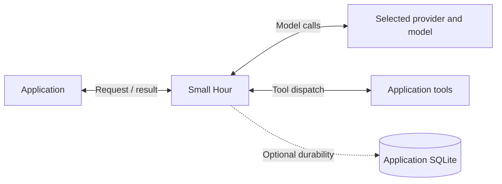

# Small Hour

Small Hour is a provider-neutral TypeScript runtime for application-defined LLM workflows, with tool execution, saved progress, spending controls, and recovery from failures.

It runs inside your application. You supply the request, instructions, relevant context, and tools or an output schema. Small Hour manages the model calls and execution checks, then returns a result and report. Your application decides what to save, show or deliver.



Read the [visual runtime guide](docs/runtime.md) for ownership, a complete tool exchange, and recovery after interrupted work.

## Capabilities

- Anthropic, OpenAI Responses, and OpenAI-compatible Chat Completions adapters.
- Fresh application-supplied instructions and memory on each turn.
- Ordered text and image input through Anthropic and OpenAI Responses.
- Sequential tools with explicit per-turn selection and required local validation, validated choices, and structured results.
- Bounded model calls, retries, deadlines, tokens, and tool results.
- Execution reports with accepted decisions, usage, tool outcomes, and receipt references.
- Optional correlated traces with explicit content capture and an application-supplied sink.
- Optional SQLite components for atomic local effects, model checkpoints, spending reservations, task execution, and saved-output delivery.

Version 0.9.0; the API is under development. Text, images, tools, and structured results are supported. Streaming and audio input are unavailable. Consumer integrations and live-model behavior require separate verification.

## Install and run

Requires Node.js 26.10 or later and ESM imports. The release includes built JavaScript and TypeScript declarations:

```sh
npm install --save-exact https://github.com/jingyufanclub/small-hour/releases/download/v0.9.0/small-hour-0.9.0.tgz
```

Supply `OPENAI_API_KEY` and `OPENAI_MODEL` in your server environment. Save this as `quickstart.mts` and run `node quickstart.mts`; it makes a billable model request. For a local environment file, use `node --env-file=.env quickstart.mts` and keep that file outside version control.

```ts
import {
  SmallHourRuntime, StaticPersonaSource, EmptyMemorySource, RuntimeError,
} from "small-hour";
import { OpenAIProvider } from "small-hour/providers/openai";

const model = process.env.OPENAI_MODEL;
if (!model) throw new Error("Set OPENAI_MODEL to a model available to your account.");

const options = {
  provider: new OpenAIProvider({ model }),
  persona: new StaticPersonaSource("Answer concisely using the supplied context."),
  memory: new EmptyMemorySource(),
  maxTokens: 1024,
  maxModelCalls: 1,
  timeoutMs: 30_000,
  retry: { attempts: 1 },
};
const runtime = new SmallHourRuntime(options);

try {
  const result = await runtime.turn({
    agentId: "example",
    input: "Describe what an agent runtime does in one sentence.",
    allowedTools: [],
  });
  if (result.status === "reply") console.log(result.output);
  console.log(result.status, result.usage);
} catch (error) {
  if (!(error instanceof RuntimeError)) throw error;
  console.error(error.code, error.report?.usage);
  process.exitCode = 1;
}
```

The example supplies static instructions, no remembered context, no tools, and one model attempt. `turn()` returns the output, status and execution report; failures expose available progress through `RuntimeError.report`. Your app validates the answer for its destination and owns persistence and delivery.

Swap the adapter for [Anthropic or an OpenAI-compatible endpoint](docs/providers.md). Add application functions through `ToolRegistry` with a required synchronous `parse` validator, select tools explicitly with `allowedTools`, or request a validated value with `structuredOutput: { schema, parse }`. Tool failures return generic feedback unless you explicitly supply a `ModelSafeToolError`; see the [tool example and API contract](docs/embedding.md). For source builds, upgrades and rollback, use the [release guide](docs/releases.md).

## Enforce a cost budget

Token, call and time limits bound execution. A monetary allowance additionally requires admission and accounting. The optional `SqliteModelSpendStore` reserves each attempt against every selected budget before dispatch and settles it from reported usage.

This extension uses your synchronous SQLite connection `database`, a stable `serviceBudgetScope` for your selected budget period, and two synchronous application functions: `estimateCall(context)` returns `{ amount, pricing }`; `chargeUsage(usage, savedPricing)` returns the actual charge. The example uses integer microdollars: $0.10 per turn and $20 across the shared service period. Choose your own limits.

```ts
import { SqliteModelSpendStore } from "small-hour/durable/sqlite";

const spending = new SqliteModelSpendStore(database);
spending.initialize();

const budgetedRuntime = new SmallHourRuntime({
  ...options,
  modelCalls: spending.hooks({
    quote: context => ({
      ...estimateCall(context),
      scopes: [
        { scope: `turn:${context.turnId}`, limit: 100_000 },
        { scope: serviceBudgetScope, limit: 20_000_000 },
      ],
    }),
    charge: chargeUsage,
  }),
});
```

Use `budgetedRuntime.turn()` with stable application-selected `turnId` values when continuing the same work. An allowance that cannot cover the reservation stops the turn with `model_call_denied` before another provider call. It does not undo previous calls or effects. Inspect totals with `spending.inspectBudget(scope)`.

Your app owns authorized scopes, budget periods, current prices and conservative estimates covering the complete request, context, tools, images and output/reasoning allowance. Small Hour supplies no rate card or estimator; the hook's explicit input does not include selected memory or accumulated tool results. Underestimates can exceed a limit; the full charge is retained and constrains later calls. Uncertain charges keep their reservations until verified reconciliation. See [spending policy and recovery](docs/model-spending.md).

## Connect your tracing

Supply a sink to send correlated turn, model, tool and output-check events to your own logger or observability system. This extension writes metadata as JSON:

```ts
const tracedRuntime = new SmallHourRuntime({
  ...options,
  tracing: {
    sink: {
      record(event) {
        console.log(JSON.stringify(event));
      },
    },
  },
});
```

Use `tracedRuntime.turn()` as above. To join an existing application trace, pass `trace: { traceId, parentSpanId }` on the turn: a nonzero 32-character lowercase hexadecimal trace ID and an optional 16-character parent span ID. Omission generates a new trace. Budget hooks and tracing can be configured on the same runtime.

Replace the logger with your own bounded export queue. `record` must return synchronously and promptly; your app owns export, flushing, redaction, access and retention. Content capture is disabled unless you add `content: { maxBytes: yourCaptureLimit }` inside `tracing`. It can include private prompts, selected context, images, tool inputs/results and outputs; oversized values are explicitly omitted. Inspect `result.trace` or `RuntimeError.report.trace` for export/capture failures. See the [tracing contract](docs/tracing.md).

## Integration requirements

Applications define workflows, facts, context selection, memory persistence, authorization, tools, output acceptance, pricing, transports, and interfaces. Configure current policies, stable identities, and evidence retention. Verify uncertain external effects before authorizing continuation.

Provider retries are owned by the runtime; SDK retries are disabled. The optional task runner owns claims and dispatch when selected. No automatic worker, polling loop, model server, or transport service starts on import.

## Reference

| Area | Contract |
| --- | --- |
| Runtime overview and ownership | [How a turn works](docs/runtime.md) |
| Pattern selection and validation ownership | [Architecture decisions](docs/architecture.md) |
| Turns, tools, choices, results | [Embedding](docs/embedding.md) |
| Limits, accounting, cancellation | [Execution](docs/execution.md) |
| Trace identity, content capture and destinations | [Tracing](docs/tracing.md) |
| Models and endpoints | [Providers](docs/providers.md) |
| Image selection, limits and storage | [Image input](docs/images.md) |
| Atomic local effects | [Local operations](docs/local-operations.md) |
| Saved model results | [Model steps](docs/model-steps.md) |
| Persistent overlapping budgets and storage ERD | [Model spending](docs/model-spending.md) |
| Claims and ordered steps | [Tasks](docs/tasks.md) |
| Saved-output handoff | [Delivery](docs/delivery.md) |
| Authorization and storage | [Security](docs/security.md) |
| Installation, compatibility and rollback | [Releases](docs/releases.md) |

Run `npm run check` for type checking, behavioral tests, and the build. `npm run check:package` verifies a clean installation of the packed artifact.
