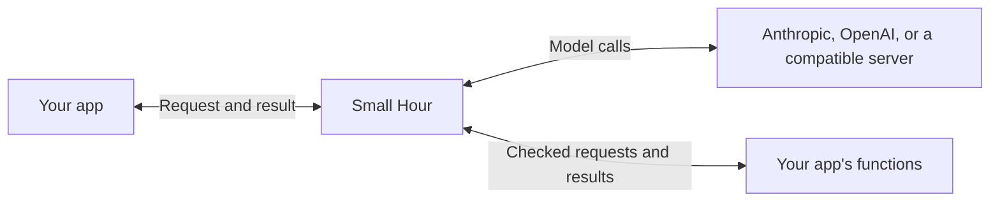

# Small Hour

Small Hour is a TypeScript library that runs the back-and-forth between your application and an AI model.

Your app supplies a request, instructions, relevant information, and the functions the model may use. Small Hour calls the model, checks and runs requested functions, and returns the answer with a record of what happened. Your app decides what to save or show.



## What it handles

- Model calls, retries, time limits, tool calls, and output validation you configure. A **tool** is a function your app lets the model request.
- Text, images, and structured data through supported [providers](docs/providers.md).
- Optional [spending controls](docs/model-spending.md), [traces](docs/tracing.md), and [saved work](docs/storage.md) for recovery after interruption.

Your app owns permissions, business rules, conversation memory, and delivery. Small Hour starts no server or worker. It returns completed responses; streaming and audio are unsupported.

## Install and try

Requires Node.js 26.10+ and ESM imports. The package includes JavaScript and TypeScript declarations.

```sh
npm install --save-exact https://github.com/jingyufanclub/small-hour/releases/download/v0.10.0/small-hour-0.10.0.tgz
```

Set `OPENAI_API_KEY` and `OPENAI_MODEL` in your server environment. Save as `quickstart.mts`, then run `node quickstart.mts`. This makes a billable request. Local `.env` files work with `node --env-file=.env quickstart.mts`; keep secrets out of Git.

```ts
import {
  SmallHourRuntime, StaticPersonaSource, EmptyMemorySource, RuntimeError,
} from "small-hour";
import { OpenAIProvider } from "small-hour/providers/openai";

const model = process.env.OPENAI_MODEL;
if (!model) throw new Error("Set OPENAI_MODEL.");

const options = {
  provider: new OpenAIProvider({ model }),
  persona: new StaticPersonaSource("Answer concisely."),
  memory: new EmptyMemorySource(),
  maxTokens: 1024,
  maxModelCalls: 1,
  timeoutMs: 30_000,
  retry: { attempts: 1 },
};
const runtime = new SmallHourRuntime(options);

try {
  const result = await runtime.turn({
    agentId: "example",
    input: "What does an agent runtime do?",
    allowedTools: [],
  });
  if (result.status === "reply") console.log(result.output);
  console.log(result.status, result.usage);
} catch (error) {
  if (!(error instanceof RuntimeError)) throw error;
  console.error(error.code, error.report?.usage);
  process.exitCode = 1;
}
```

This example makes one model attempt, with no tools or remembered context. It returns the answer and usage; failures expose available progress in `error.report`.

## Next steps

| I want to… | Read |
| --- | --- |
| Understand the flow and responsibilities | [How it works](docs/runtime.md) · [Architecture](docs/architecture.md) |
| Add tools or get validated JSON | [Tools and results](docs/embedding.md) |
| Set limits and a money budget | [Execution limits](docs/execution.md) · [Spending](docs/model-spending.md) |
| Use my logger or tracing system | [Tracing](docs/tracing.md) |
| Save progress or run several steps | [Storage](docs/storage.md) · [Tasks](docs/tasks.md) |
| Handle private data and upgrades | [Security](docs/security.md) · [Releases](docs/releases.md) |

Money budgets require your prices and estimates. Tracing requires your destination for events. Saved work requires your SQLite connection. Each is optional.

Development: `npm run check`; package verification: `npm run check:package`.

Copyright 2026 Jing Yu. [Apache-2.0](LICENSE).
