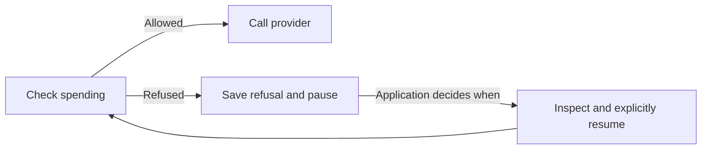

# Wait for budget without losing retries

A budget refusal means the model was never called. Recoverable work can pause for that refusal while preserving its retry allowance.

## Opt in before execution

Add this to the original model step's recovery contract:

```ts
recovery: {
  sideEffectFree: true,
  maxAttempts: 3,
  maxModelCalls: 5,
  admissionDenials: "pause",
}
```

The limits are examples. The usual [tool-free recovery requirements](model-recovery.md) apply. Without this option, admission refusals count toward the limits. Existing saved contracts cannot gain this permission; use a new workflow version for new work.

Your `modelCalls.admit` hook must return `false` for a known refusal and throw for an admission failure. The [spending store](model-spending.md) already does this. Small Hour records `admission: "denied"` alongside `status: "not_started"`. An unmarked `not_started` call does not qualify.

## What is preserved

- A failed model attempt containing only that saved refusal does not consume `maxAttempts`.
- Marked refused calls do not consume cumulative `maxModelCalls`. Actual, uncertain, and unmarked calls still count.
- The task becomes `paused`, with reason `model_admission_denied`. Raw `attempts` remain visible; `admissionPauses` counts credited claims. The task limit applies to `attempts - admissionPauses`.
- Saved input, earlier results, call IDs, refusal history, and spending records remain intact. A refusal after a provider call in the same model attempt does not credit that attempt or task claim.

## Resume explicitly

`run` and `runNext` skip paused tasks. Your app decides when eligibility has changed, inspects the task, and calls `retryModel` with the model step's current checkpoint, reason, and evidence. Standalone stores use `recover`. Each invocation stops after one refused admission; no waiting loop starts.



Permission, cancellation, and concurrency are checked again. Paused tasks release their concurrency scope; applications that require ordering must enforce it. `cancel` closes a paused task. Other permission deferrals keep their existing claim limits.

Refusals do not release earlier reservations or reconcile unknown charges. Incomplete evidence or failed pause writes can leave work uncertain and its claim counted; inspect and reconcile before further action. Apps own resume frequency, permanent-denial handling, and retention; each resumption adds evidence.

Before enabling this contract, upgrade all readers and call `runner.initialize()`. It adds `admission_pauses`, defaulting existing tasks to zero. Older packages cannot handle opted-in work. Follow the [upgrade and rollback procedure](releases.md).
