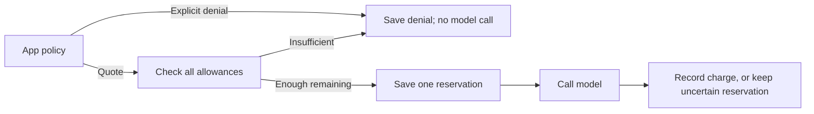

# Set a money budget

A token limit controls response size. A money budget controls spending across requests. `SqliteModelCallStore` checks each attempt against your allowances before dispatch.

**Your app supplies prices and conservative cost estimates.** Small Hour has no built-in price list or estimator.

## Connect it

This extends the [quickstart's runtime options](../README.md#install-and-try). Supply a synchronous SQLite `database`, a stable `serviceBudgetScope` for your budget period, and synchronous `estimateCall` / `chargeUsage` functions:

```ts
import { SqliteModelCallStore } from "small-hour/durable/sqlite";

const spending = new SqliteModelCallStore(database, {
  content: { maxBytes: captureLimitBytes },
});
spending.initialize();

const budgetedRuntime = new SmallHourRuntime({
  ...options,
  modelCalls: spending.hooks({
    quote: (context, request) => ({
      ...estimateCall(context, request),
      scopes: [
        { scope: `turn:${context.turnId}`, limit: 100_000 },
        { scope: serviceBudgetScope, limit: 20_000_000 },
      ],
    }),
    charge: chargeUsage,
  }),
});
```

Here amounts are integer microdollars: $0.10 per turn and $20 for the shared period. Supply your capture byte limit, or omit `content` for metadata only. Pick your own limits and units. Preserve `turnId` when continuing the same work.

A **scope** identifies a shared allowance. One call must fit every selected scope; its charge counts once in each.

## How the budget works



A denial raises `model_call_denied`. Storage failure also prevents dispatch. Earlier charges remain; reservations never expire automatically. Every provider retry needs its own reservation. When pricing is unavailable, return an [explicit policy denial](spending-records.md#deny-before-pricing) to save the reason without fabricating a quote.

Recoverable tasks can opt into [admission pauses](admission-pauses.md) so budget refusals preserve their retry allowance.

## Your pricing functions

- `estimateCall(context, request)` returns `{ amount, pricing }`. Use nonnegative safe integers; `pricing` is a saved JSON snapshot.
- `chargeUsage(usage, pricing)` returns the actual charge using that snapshot and every billable token category.

The runtime supplies the complete normalized request as the second argument: instructions, selected context, accumulated tool results, schemas, images and output/reasoning allowance. Manual hook callers may supply their provider-native request and completion; record the format in call attributes. The store captures either format without translating it. An underestimate can exceed the allowance; the full charge is retained and constrains later calls.

Callbacks must cause no effects or transactions. Schema initialization can join your app's setup transaction; commit setup before execution. Admission, settlement, and reconciliation require independent transactions. Authenticate scope selection and keep scopes stable across retries.

## Inspect or resolve uncertain cost

`inspectBudget(scope)` reports charged, reserved, unknown, and total amounts. `inspect(callId)` shows the saved quote, outcome, and evidence. Do not sum overlapping scopes as total spending.

`reconcile(callId, outcome)` resolves reserved/unknown calls using verified evidence. Output refusal can still cost money. Timeout or cancellation alone cannot establish whether a call was charged; keep uncertain amounts reserved until your app verifies the outcome. See [spending records](spending-records.md) for settlement rules. Completed model-step replay adds no charge.

The default store hook throws on settlement failure. An application that can safely continue with the provider result may catch that error in its `record` hook and return `"unrecorded"`. The runtime preserves that accounting status while applying normal output/tool checks. Keep the reservation, report the unresolved accounting and reconcile it from evidence; returning this status does not retry or release spending.
