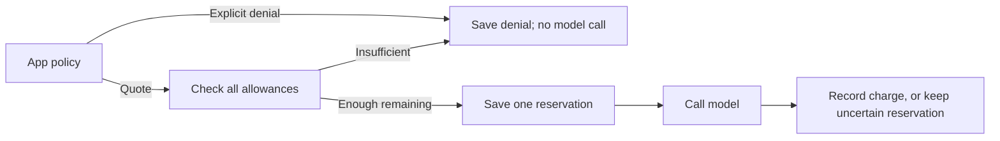

# Set a money budget

A token limit controls one response's size. A money budget controls spending across requests. The optional `SqliteModelSpendStore` checks each model attempt against your allowances before allowing it to start.

**Your app supplies prices and conservative cost estimates.** Small Hour has no built-in price list or estimator.

## Connect it

This extends the [quickstart's runtime options](../README.md#install-and-try). Supply a synchronous SQLite `database`, a stable `serviceBudgetScope` for your budget period, and synchronous `estimateCall` / `chargeUsage` functions:

```ts
import { SqliteModelSpendStore } from "small-hour/durable/sqlite";

const spending = new SqliteModelSpendStore(database);
spending.initialize();

const budgetedRuntime = new SmallHourRuntime({
  ...options,
  modelCalls: spending.hooks({
    quote: context => ({
      ...estimateCall(context),
      scopes: [
        { scope: `turn:${context.turnId}`, limit: 100_000 },
        { scope: serviceBudgetScope, limit: 20_000_000 },
      ],
    }),
    charge: chargeUsage,
  }),
});
```

Here amounts are integer microdollars: $0.10 per turn and $20 for the shared period. Pick your own limits and units. Use `budgetedRuntime.turn()` and preserve its `turnId` when continuing the same work.

A **scope** identifies a shared allowance. One call must fit every selected scope; its charge counts once in each.

## How the budget works



A denial raises `model_call_denied`. Storage failure also prevents dispatch. Earlier charges remain; reservations never expire automatically. Every provider retry needs its own reservation. When pricing is unavailable, return an [explicit policy denial](spending-records.md#deny-before-pricing) to save the reason without fabricating a quote.

## Your pricing functions

- `estimateCall(context)` returns `{ amount, pricing }`. Use nonnegative safe integers; `pricing` is a saved JSON snapshot.
- `chargeUsage(usage, pricing)` returns the actual charge using that snapshot and every billable token category.

Estimate the complete request: input, selected context, accumulated tool results, images, and output/reasoning allowance. **The hook's explicit input does not include selected memory or accumulated tool results.** Your estimator must account for them separately. An underestimate can exceed the allowance; the full charge is retained and constrains later calls.

Callbacks must cause no effects or transactions. Schema initialization can join your app's setup transaction; commit setup before execution. Admission, settlement, and reconciliation require independent transactions. Authenticate scope selection and keep scopes stable across retries.

## Inspect or resolve uncertain cost

`inspectBudget(scope)` reports charged, reserved, unknown, and total amounts. `inspect(callId)` shows the saved quote, outcome, and evidence. Do not sum overlapping scopes as total spending.

`reconcile(callId, outcome)` resolves reserved/unknown calls using verified evidence. Output refusal can still cost money. Timeout or cancellation alone cannot establish whether a call was charged; keep uncertain amounts reserved until your app verifies the outcome. See [spending records](spending-records.md) for settlement rules. Completed model-step replay adds no charge.
