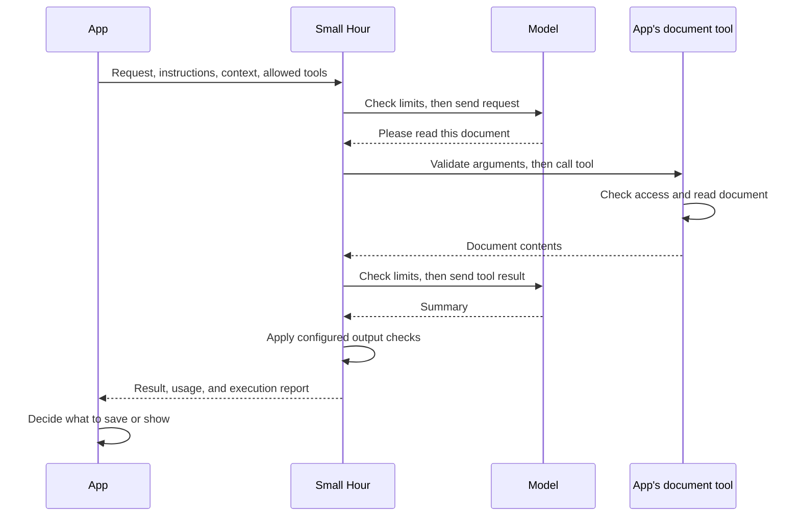

# How Small Hour works

Small Hour handles the model calls and tool calls needed to answer one application request. That whole exchange is a **turn**. A turn can need several model calls: the model asks for information, your app supplies it, and the model answers.

## Follow one request

Suppose your app asks the model to summarize a document. Your app provides a tool that reads documents the caller is allowed to access.

Your app chooses the provider and model. A **provider adapter** translates Small Hour's requests into that provider's API format.

## Who decides what?

| Owner | Decisions |
| --- | --- |
| Your app | Instructions, relevant information, available tools, permissions, acceptable answers, and what users receive. |
| Model | How to interpret the request, which offered tools to request, and what answer to generate. |
| Small Hour | When another call is allowed, how tools run, and whether the response passes configured checks. |

Small Hour loads instructions and context fresh for each turn. **It keeps no conversation history between turns.** Your app supplies anything the model should remember.

You can also request [structured data](embedding.md#structured-results), such as a validated JSON object. That mode uses no tools and makes no automatic repair call when validation fails.

## What stops the work?

Calls, retries, time, output tokens, and tool-result sizes have [limits](execution.md). Optional [spending controls](model-spending.md) check a reservation before each model attempt. Reaching a limit stops further work and returns an error with available progress. Earlier effects or charges remain.

Truncation, refusal, and unknown provider endings do not become accepted answers. The default text policy accepts completed text; your app supplies checks for meaning, factual accuracy, or tone.

## What survives a crash?

The core keeps nothing on disk. Optional [storage helpers](storage.md) save completed results and progress in your database. Completed work can be reused. Unfinished work needs your app to check what happened before continuing.

Keep four outcomes separate: **the model finished**, **the answer passed checks**, **the result was saved**, and **the user received it**. Each needs its own evidence.
