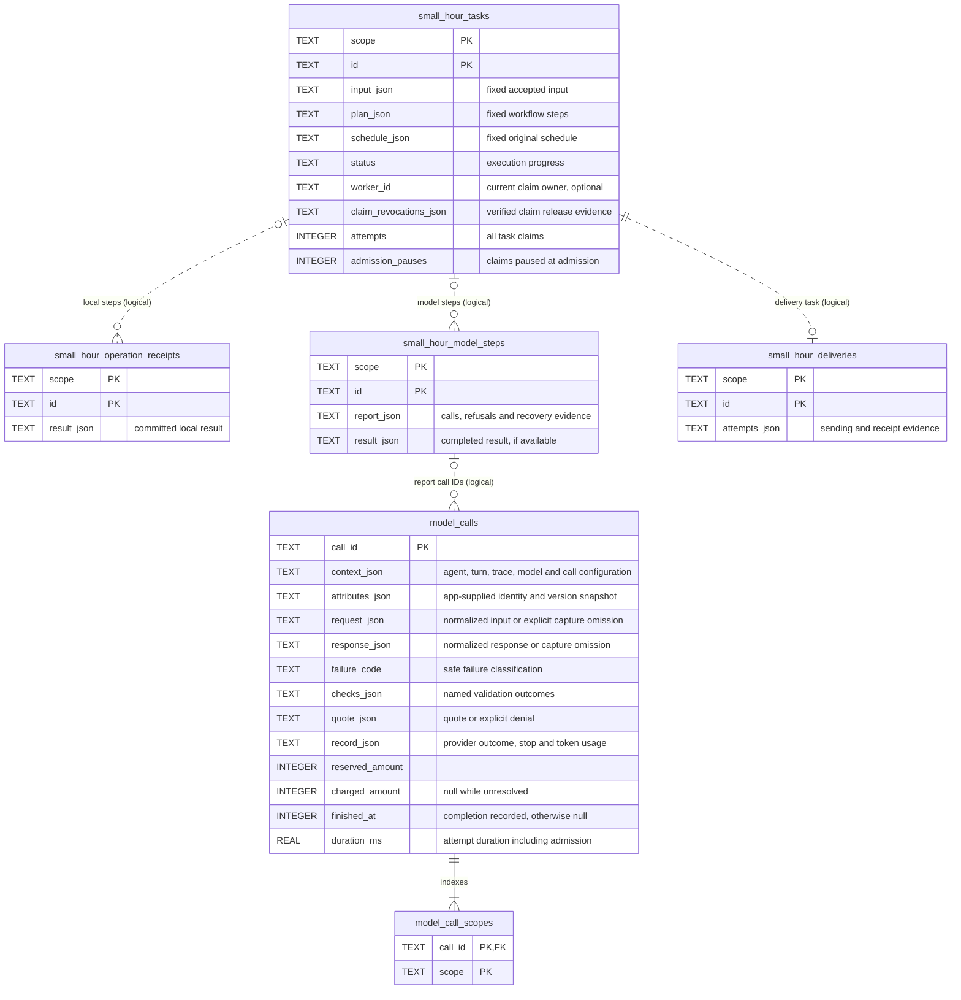

# Storage reference

See [why storage is useful](storage.md).

## Relationships and authority

`scope` and `id` identify saved work. Local receipts and model steps may exist independently. Task-step identities derive from the task and step; delivery evidence shares its task's identity.

The ERD shows selected columns. Dotted relationships follow IDs in execution reports; budget memberships use a SQL foreign key. A model call is one provider attempt, including denied attempts. A turn can contain several calls. These relationships do not make separate requests one transaction.

SQLite guards protect accepted task identity, input, steps, and original schedule, including concurrency scope. Current due times and execution progress remain mutable. Applications control deletion and schema access; the guards do not prevent deliberate database tampering.

Enable SQLite foreign-key checks. Memberships index one call's charge under every applicable budget; they contain no independent balance. The call row owns input, response/failure, checks, tokens and accounting. Recovery reports reference its call ID and retain the progress/result required for replay. Applications own access and domain links; a trace ID grants no permission.

`admission_pauses` counts [claim credits](admission-pauses.md) backed by model refusals; credits cannot release money or erase history.

## Lifecycle timestamps

All six tables have `created_at` and `updated_at`, exposed as `createdAt` and `updatedAt`: integer milliseconds since the Unix epoch. The new call and scope tables require them and provide SQL defaults. Older recovery tables allow `null` when historical time is unknown.

- `createdAt` records the first insertion. Recovery keeps that time.
- `updatedAt` records a saved change, including claim renewal or stronger delivery evidence.
- Reading, completed replay, duplicate enqueue, and identical reconciliation preserve times.
- Budget memberships keep their admission times; settlement updates the call row.
- Migrated records keep unknown historical times. A later change can set `updatedAt` while `createdAt` stays `null`.

Stores accept `{ now: () => milliseconds }`, defaulting to `Date.now`. The runner shares its clock with its stores. Times never move backward; equal times are possible. Timestamps cannot establish remote outcomes or authorize recovery.

Local receipts and enqueued tasks remain provisional until an enclosing transaction commits; these timestamps do not record that outer commit. Delivery timestamps describe local evidence, not remote receipt time. Unattempted deliveries have null times.

See [upgrades](releases.md#0100) before opening old data. Your app owns retention; no automatic cleanup runs.

`SqliteModelCallStore.initialize()` creates the complete fresh schema. It refuses an existing `small_hour_model_spend` store; no automatic migration or backfill runs. Never discard retained charges or start a second allowance to bypass this refusal.
