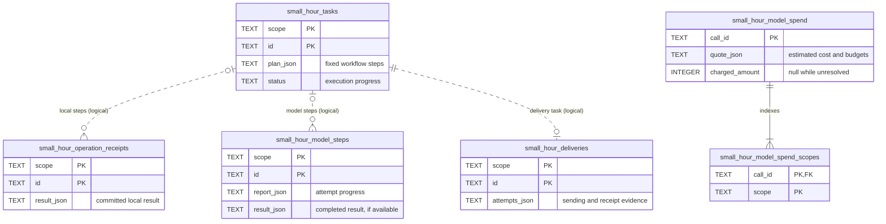

# Storage reference

Start with [why storage is useful](storage.md). This page maps the saved records to SQLite tables and explains their timestamps.

## Relationships and authority

`scope` and `id` together identify an operation, model step, task, or delivery. Receipts and model steps can exist without a task. Runner step IDs derive from the task and step identities; delivery evidence uses the delivery task's identity.

This ERD shows selected columns. Dotted lines are relationships enforced by application/runtime code. Only the spending membership link is a SQL foreign key.

Enable SQLite foreign-key checks. Budget memberships point to one call; they have no independent balance. Keep both tables together. Spending call IDs also appear in model reports when accounting is configured.

## Lifecycle timestamps

All six tables have nullable `created_at` and `updated_at` columns. Public records expose `createdAt` and `updatedAt`: nonnegative integer milliseconds since the Unix epoch, or `null` when historical time is unknown.

- `createdAt` records the first insertion. Recovery keeps that time.
- `updatedAt` records a saved change, including claim renewal or stronger delivery evidence.
- Reading, completed replay, duplicate enqueue, and identical reconciliation preserve times.
- Budget memberships keep their admission times; settlement updates the call row.
- Migrated records keep unknown historical times. A later change can set `updatedAt` while `createdAt` stays `null`.

Standalone stores accept `{ now: () => milliseconds }`; the default is `Date.now`. The runner shares its clock with its stores. Update times never move backward; equal times are possible. They cannot establish a remote outcome or authorize recovery.

Local receipts and enqueued tasks remain provisional until an enclosing transaction commits; these timestamps do not record that outer commit. Delivery timestamps describe local evidence, not remote receipt time. Unattempted deliveries have null times.

See [upgrades](releases.md#0100) before opening old data. Your app owns retention; no automatic cleanup runs.
