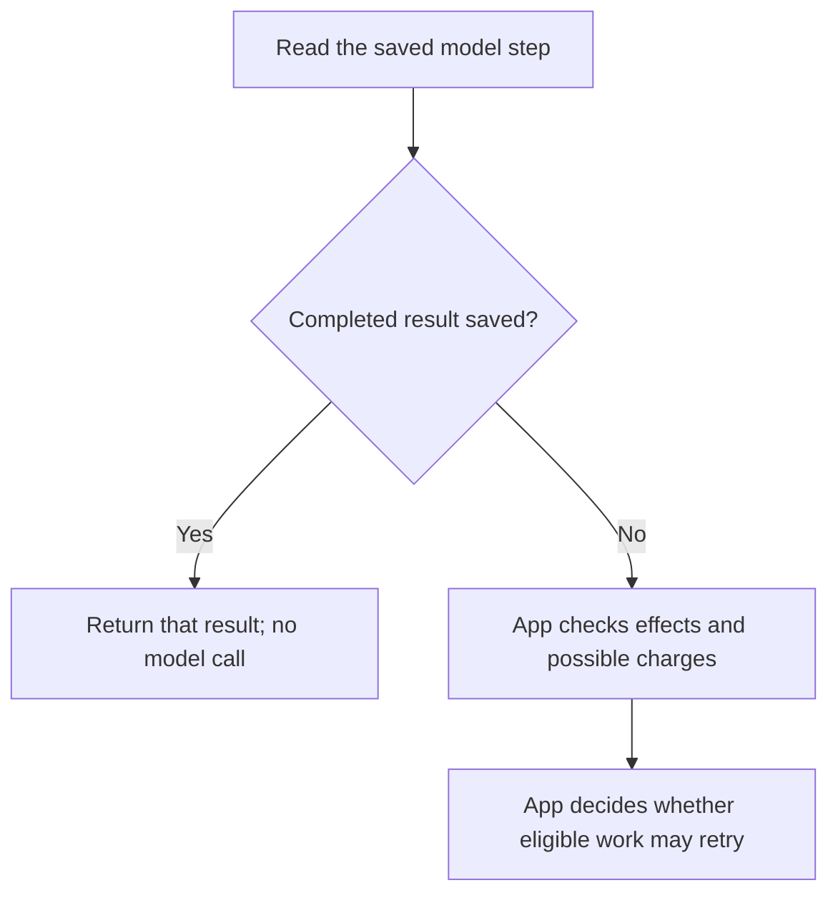

# Saving work and recovering after a crash

Small Hour's storage helpers answer: **what already happened, and is it safe to continue?** They are optional. Ordinary `runtime.turn()` calls create no database and save no history.

For example, your app asks a model to extract fields from a document. If the finished result was saved before the app crashed, Small Hour can return that result without paying for another model call. If the app crashed during the call, Small Hour keeps the available progress and waits for your app to decide what to do.

## Choose only what you need

| You need to… | Use | What is saved |
| --- | --- | --- |
| Avoid repeating a committed database change | [Local operations](local-operations.md) | A **receipt**: the operation's identity and result, saved with the change. |
| Reuse a finished model result | [Model steps](model-steps.md) | The explicit input, settings, progress, and completed result. |
| Share a money budget across requests | [Model spending](model-spending.md) | Reserved amounts, known charges, and unresolved costs. |
| Resume an ordered workflow | [Tasks](tasks.md) | Its steps, schedule, current owner, and progress. |
| Track sending an already-saved output | [Delivery](delivery.md) | Sending attempts and evidence of acceptance or receipt. |

These records help execution recover. Your app still owns its documents, users, conversation memory, and other product data. [Tracing](tracing.md) separately explains what happened inside a turn.

## Where does it go?

You supply an existing SQLite connection. Import helpers from `small-hour/durable/sqlite`; call a helper's `initialize()` to create or upgrade its tables. No separate database service or background worker is installed.

The task runner initializes its task table plus the stores required by its registered step types. A workflow with only local and model steps needs no delivery table. Your app initializes spending separately.

## After interruption

**Replay** means returning a saved result. **Reconciliation** means checking records or the external service to establish what really happened. A timeout alone proves neither failure nor zero cost. Only model steps that opted into tool-free recovery can use the built-in retry path.

## Your app's responsibilities

Choose stable operation IDs, check permission, protect stored content, and manage backups and retention. Model-step input and results can include private text and images. Keep records long enough to prevent duplicate work and account for spending.

Before upgrading existing data, read [Releases](releases.md#0100). For table relationships and `createdAt` / `updatedAt`, see the [storage reference](storage-schema.md).
