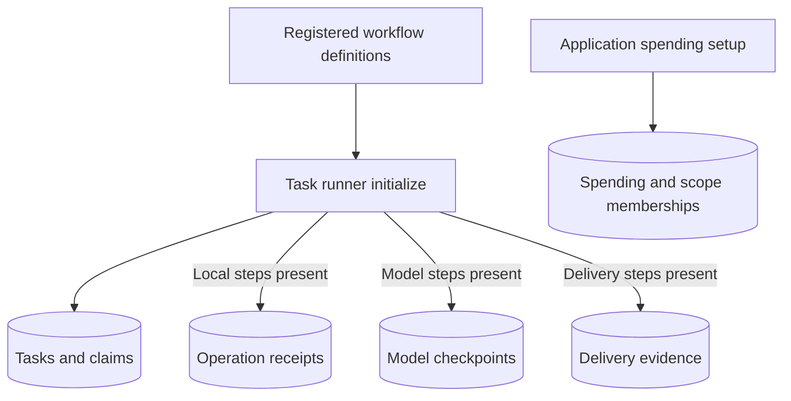
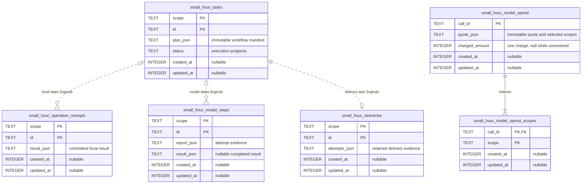

# Durable storage

Durable components use the application's synchronous SQLite connection. They retain execution evidence; applications own domain records, authorization, retention and backups. Each component's `initialize()` creates or upgrades its tables. See [upgrade and rollback requirements](releases.md#0100) before opening existing data.

## Required stores

The task runner initializes its task table and only the evidence stores used by registered step kinds. Local/model workflows can initialize, execute, recover and inspect their work without delivery storage. Register the original workflow versions when resuming work. A spending store is initialized separately by the application.

## Lifecycle timestamps

Saved receipts, model-step states/results, spending records, task states and delivery states expose `createdAt` and `updatedAt`: nonnegative integer milliseconds since the Unix epoch, or `null` for unknown historical times. SQL columns are `created_at` and `updated_at`.

- Creation records the first insertion of the logical record. Recovery attempts keep that identity and creation time.
- Update records a persisted lifecycle or evidence change, including task claims/lease renewal and stronger delivery evidence. Inspection, completed replay, duplicate enqueue and identical reconciliation preserve both times.
- Spending scope memberships are immutable projections: their two times equal admission time. Settlement changes only the parent call, which owns the charge.
- Existing records gain nullable columns without invented historical dates. A later real change can establish `updatedAt` while `createdAt` remains `null`.

Construct standalone stores with optional `{ now: () => epochMilliseconds }`; omission uses `Date.now`. The runner passes its `now` clock to its evidence stores. Update times never move backward within a record. Equal milliseconds are possible; timestamps are neither revision tokens nor proof of provider execution, payment or delivery. Continue using checkpoints, claims and verified receipts for those decisions. Due times and lease expiry retain their scheduling meaning.

Local receipts and queued tasks remain provisional until an enclosing application transaction commits. Timestamps describe the stored changes, not that outer commit time. Delivery timestamps describe locally retained evidence, not a remote device's clock. A delivery with no recorded attempt has null times. Completed local task steps expose their saved `receipt` alongside `result`.

## Relationships and authority

`scope` and `id` together identify receipts, model steps, tasks and deliveries. Standalone receipts/model steps need no task. Runner step identities derive from the task identity and step ID; delivery evidence shares the delivery task's identity. Dotted links below are application-enforced relationships, not SQL foreign keys. Spending call IDs also appear in model reports when accounting is configured.

Enable SQLite foreign-key checks for database enforcement of spending memberships. Keep each call and its membership rows together; they contain no independent balance. Keep task evidence through its retry/reconciliation window. Deleting receipts or reservations removes duplicate protection or budget history. No background retention job or transcript archive is supplied.
