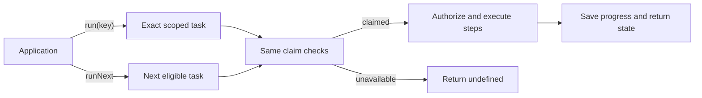

# Run an ordered workflow

Use `SqliteTaskRunner` for fixed steps that must survive interruption: save a database change, ask a model to analyze it, then save the result.

Your app defines and submits tasks and decides when to call the runner. **Small Hour starts no polling loop or worker.**

## Define and submit

Construct it with your synchronous SQLite connection, workflow definitions, and `{ leaseMs, now? }`. `initialize()` prepares task storage and stores needed by registered steps. Initialize spending separately.

A workflow has `kind`, `version`, ordered unique step IDs, and synchronous `authorize(context)`.

| Step | Callback |
| --- | --- |
| `local` | Synchronous SQL `execute(database, context)` and JSON-preserving `parseResult`. |
| `model` | Synchronous `prepare(context)` returns `{ runtime, input }`. |
| `delivery` | App-supplied sending function; must be the only step. See [delivery](delivery.md). |

Context includes the task, step ID, preceding results, cancellation signal, and `assertActive()`. Preparation, parsing, authorization, and retry selection must have no effects.

`enqueue(request, { concurrencyScope, dueAt, maxAttempts })` saves an [operation identity](local-operations.md#identity-and-results), step definition, and schedule. Exact duplicates return existing state; changes conflict. Enqueue can join a local transaction, remaining provisional until commit.

## Run work

`run({ scope, id }, { signal? })` selects only that task. `runNext({ signal? })` selects the next eligible task. Both return inspected state with any transient `error`, or `undefined` when no selected work is eligible. Targeted execution never falls through to another task. Use `inspect(key)` for completed state and `retryModel` for uncertain model work.

Both enforce due times and skip unknown workflow versions; retain definitions for pending tasks. Selecting a key grants no permission.

A **claim** gives temporary ownership until its **lease** expires after `leaseMs`. A **concurrency scope** prevents overlapping work; running or uncertain tasks hold it.

Every claim consumes an attempt, including permission deferral and recovery. Permission returns `allow`, `rejected` with a reason, or `deferred` with a reason/due time.

Completed steps reuse saved results. New steps recheck permission; rejected model output rejects the task. Deferral reserves no ordering.

Leases renew between steps; allow longer than the longest step. There is no heartbeat. Stale workers cannot commit later local steps or finalize work. Remote effects need duplicate protection.

## Inspect, cancel, recover

- `inspect(key)`: progress, reasons, attempts, timestamps, and step evidence, including local receipts.
- `cancel(key, reason)`: stop queued/deferred work or request cancellation of running/uncertain work. Completed effects remain.
- `retry(error, context)`: optional scheduling of rolled-back local work within its attempt limit.
- `retryModel(...)`: explicit [recovery of eligible model work](model-recovery.md#through-the-task-runner); unfinished model work never repeats automatically.
- `resolve(key, { status, reason, evidence })`: close verified uncertain work as failed/cancelled without replay or refund.

Storage errors propagate. Replace or restore the connection after `rollback_failed`. Retain evidence and compatible handlers through [upgrades](releases.md).
