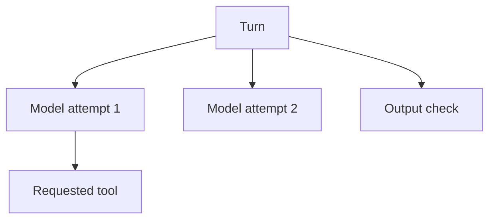

# See what happened in a turn

Tracing records the model calls, tool calls, output checks, timing, and available usage within a request. It helps answer: **what did the model receive, what did it ask to do, and where did the request fail?**

Small Hour emits events. Your app sends them to its logger, database, or observability service and owns dashboards, access, and retention.

## Connect your own tracing

This extends the [quickstart's runtime options](../README.md#install-and-try):

```ts
const tracedRuntime = new SmallHourRuntime({
  ...options,
  tracing: {
    sink: {
      record(event) {
        traceBuffer.enqueue(event);
      },
    },
  },
});
```

Supply `traceBuffer` as your bounded export queue. `record` must return synchronously and promptly; your app handles delivery, retries, shutdown flushing, and storage acknowledgements. A simple local logger can use `console.log(JSON.stringify(event))`.

## Join related work

A **trace ID** joins events from one request. A **span ID** identifies one operation within it.



Pass `trace: { traceId, parentSpanId }` to `turn()` to join an existing trace. IDs are nonzero lowercase hexadecimal: 32 characters for the trace, 16 for the optional parent span. Omission creates a new trace.

Events include timestamps, sequence numbers, IDs, available usage, stop reasons, tool outcomes, and check verdicts. Finish events include elapsed time. Errors use codes rather than exception messages. Application-selected IDs can still identify people.

## Capture content deliberately

By default, events contain metadata only. Add `content: { maxBytes: captureLimitBytes }` inside `tracing` to capture content; supply a positive byte limit.

Capture can include prompts, selected context, schemas, model responses, tool arguments/results, and final output. Built-in adapters also expose the actual request and decoded response bodies, excluding transport credentials and headers. These bodies can contain private text and images.

Each content field says `captured`, `omitted`, or `unavailable`. Oversized fields are omitted with their size; nothing is silently clipped. Unsafe serialization is unavailable. Native thinking returned by a provider may be captured; tracing cannot reveal hidden reasoning.

## Failure and recovery

Check `result.trace` or `RuntimeError.report.trace` for export failures and omissions. Sink failures do not retry work or change its outcome; slow synchronous sinks still consume execution time. Event handoff does not prove storage.

Save and resupply trace IDs to connect workflow steps and recovery. Completed [model-step replay](model-steps.md) returns saved trace metadata without new model/tool events.

Trace IDs do not replace operation IDs. Content settings do not change durable storage. Tracing observes work; required audit-before-action checks need an application enforcement boundary.
